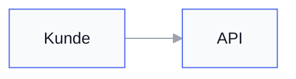

# Minimaler Diagramm-Stil

Ziel: sieht aus wie von einem guten Produktdesigner, nicht wie Standard-Tool-Output.

## Prinzipien

1. **Eine Akzentfarbe**, Rest neutral. Vorschlag: Akzent `#4F6BED` oder `#0F766E`; Neutral: `#111827` (Text), `#E5E7EB` (Linien), `#F9FAFB` (Füllung hell), Weiß (Hintergrund).
2. **Keine Gradienten, keine Schatten, keine 3D-Kästen.**
3. **Kontrast statt Farben-Regenbogen:** Hierarchie über Füllung (hell Akzent = wichtig) statt vieler Farben. Max. 3 Farbstufen.
4. **Runde Ecken** (border-radius ~6px) bei Boxes.
5. **Kurze Labels**, Title-Case vermeiden; Subtext in grau (#6B7280), kleiner.
6. **Abstand:** Nodes nicht aneinanderkleben; ranksep/nodesep großzügig.

## Mermaid: Init-Block am Anfang des Sources



- `theme: base` + `themeVariables` ist der sauberste Weg, das Default-Look komplett zu ersetzen.
- Kanten-Beschriftungen sparsam; Pfeil `---` statt `-->` wenn Richtung egal.
- `flowchart` statt `graph` verwenden (modernere Syntax).

## PlantUML: skinparam-Block

```plantuml
@startuml
skinparam {
  BackgroundColor #FFFFFF
  ArrowColor #9CA3AF
  ArrowThickness 1.5
  BorderColor #4F6BED
  BorderThickness 1.5
  RoundCorner 12
  Shadowing false
  DefaultFontName Helvetica
  DefaultFontSize 14
  DefaultFontColor #111827
  SequenceArrowThickness 1.5
  ParticipantBackgroundColor #F9FAFB
  ParticipantBorderColor #4F6BED
}
@enduml
```

## GraphViz: dot-Header

```dot
digraph {
  graph [bgcolor="white", pad=0.3, nodesep=0.5, ranksep=0.8, fontname="Helvetica"];
  node  [shape=box, style="rounded,filled", fillcolor="#F9FAFB", color="#4F6BED",
         fontname="Helvetica", fontsize=12, margin="0.15,0.1"];
  edge  [color="#9CA3AF", arrowsize=0.7, fontname="Helvetica", fontsize=10, fontcolor="#6B7280"];
}
```

## D2 (wenn verfügbar)

```d2
style: {
  fill: "#F9FAFB"
  stroke: "#4F6BED"
  border-radius: 6
  font: Helvetica
}
```

## Anti-Patterns (nie machen)

- Default-Mermaid-Look (violett/blau bunt) für Kunden-/Management-Diagramme unverändert liefern
- Rot/Grün als einzige Bedeutungsträger (Barrierefreiheit)
- Mehr als ~7 Nodes pro Zeile im Flowchart → aufteilen oder Subgraph
- Schräge Pfeile, gestrichelte Box-Rahmen als Hauptstil

## Regel

Vor dem Rendern (siehe Skill `kroki-diagrams`) den Styling-Block in den Diagramm-Source einbauen, dann erst an die Kroki-API schicken.
