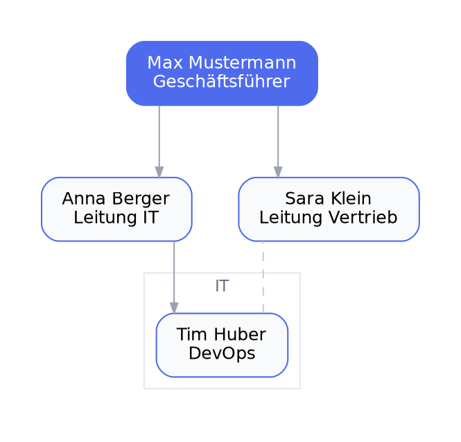
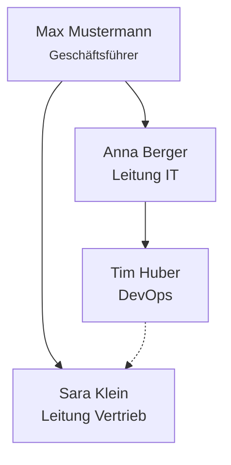

# Organigramme zeichnen

## Typwahl nach Anlass

| Anlass | Empfohlener Typ |
|---|---|
| Einfache Hierarchie, schnell | **mermaid** `flowchart TD` |
| Schickes, formales Organigramm | **graphviz** (dot, rankdir=TB) |
| Rollen + Abteilungs-Cluster, viele Personen | **graphviz** mit `subgraph` pro Abteilung |
| WBS-artige Baumstruktur | **plantuml** `wbs` |
| Gepunktete Berichtslinien (dotted line) | graphviz `style=dashed` |

Standard: **graphviz dot** — gibt die beste Kontrolle über Abstand, Cluster und Kanten.

## Graphviz-Template (modern, via minimal-diagram-style)



## Mermaid-Template (schnelle Variante)



## Regeln

1. **Pro Node: Name + Rolle** (zwei Zeilen, Rolle klein/grau). Nie nur Namen ohne Funktion.
2. **Cluster = Abteilungen**, mit dezentem Label oben.
3. Gleiche Hierarchieebenen mit `{ rank=same; ... }` ausrichten.
4. Dotted lines (`style=dashed` / `-.->`) nur für Nebenlinien — Legende einbauen wenn mehr als eine.
5. >~25 Personen: nicht ein Diagramm quetschen — pro Abteilung ein Chart oder interaktiv (HTML).
6. Render-Call (Kroki):

```bash
curl -sS https://kroki.io/graphviz/svg \
  -H 'Content-Type: text/plain' --data-binary @org.dot -o org.svg
```

7. Ergebnis-Datei kurz prüfen (existiert, beginnt mit `<svg`), dann dem Nutzer Pfad + Datei geben.
8. PII-Hinweis: echte Namen in Diagrammen — Nutzer ggf. auf Self-Host-Kroki hinweisen (siehe `kroki-diagrams`).
